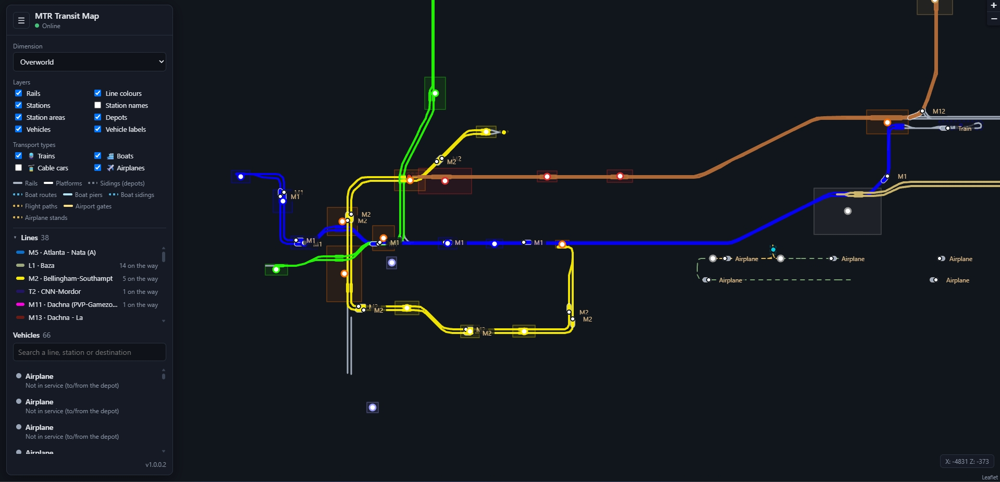
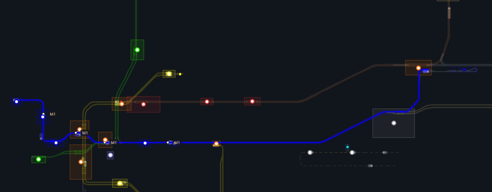
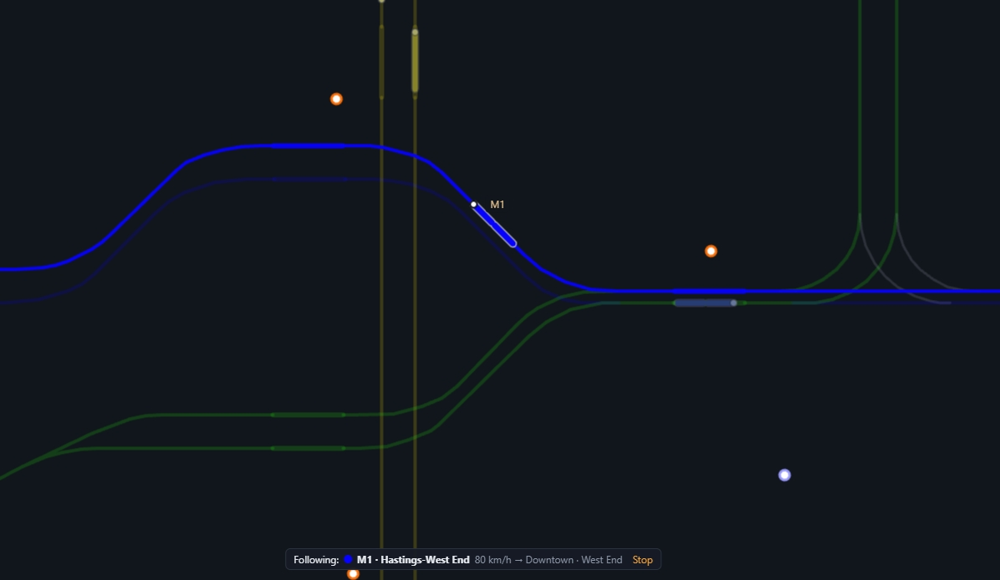
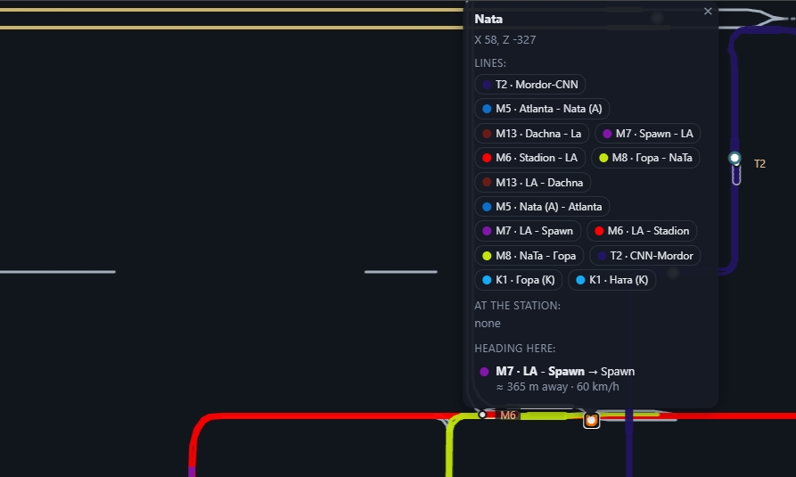
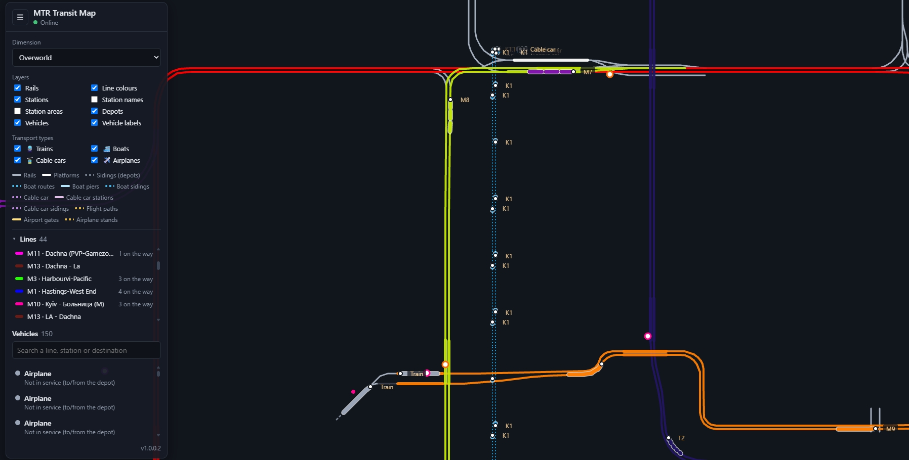
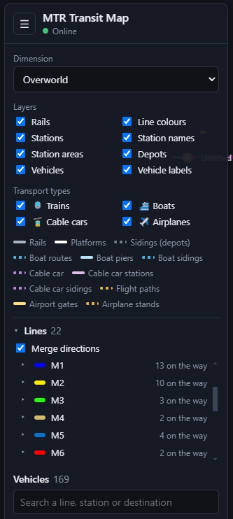

<div align="center">


# MTR-Dynmap Bridge

**Live web map of Minecraft Transit Railway vehicles, plus MTR stations and depots on Dynmap**

[](RELEASE_NOTES.md) [](#requirements) [](#requirements) [](https://modrinth.com/mod/minecraft-transit-railway) [](#dynmap-markers)

[Features](#features) • [Web map](#web-map) • [Installation](#installation) • [Configuration](#configuration) • [Commands](#commands) • [Troubleshooting](#troubleshooting) • [Version history](#version-history)

</div>

---

<p align="center">
  
  <br/>
  <sub><i>The built-in live web map — every MTR line, station and vehicle of the server in one browser tab.</i></sub>
</p>

<a id="features"></a>

## ✨ Features

<table>
<tr>
<td width="50%" valign="top">

### 🗺️ Live web map
- Every MTR rail, **straight and curved**, in its real place
- Rails **coloured like your MTR lines**, platforms and depot sidings marked
- Stations with their **areas**, depots
- **Lines list** with highlighting — both directions of a line shown as **one line**
- **Smoothly moving vehicles** — trains, boats, cable cars, airplanes
- Vehicle list with **search** and **"follow this vehicle"**
- **Switches per transport type** — hide trains, boats, cable cars or airplanes with one tick
- Station window: vehicles **at the station** and **heading there**, split by direction
- English 🇬🇧 / Russian 🇷🇺 interface

</td>
<td width="50%" valign="top">

### 📍 Dynmap markers
- MTR stations (`pin`) and depots (`building`) on Dynmap
- Same markers as 1.0.0.1 — existing ones are simply kept up to date
- Deleted stations and depots disappear automatically
- Automatic MTR dimension → world mapping
- Configurable icons and sync interval
- **Dynmap is optional** — the plugin works without it

</td>
</tr>
<tr>
<td width="50%" valign="top">

### ⚡ Built for live servers
- Data is read **on MTR's own simulation thread** — the Minecraft thread is never touched
- Rail shapes are calculated once and **cached**
- Website served from separate (virtual) threads
- Viewers receive **only what changed**

</td>
<td width="50%" valign="top">

### 🛠️ Admin tools
- `/mtrmap` — clickable link to the web map for everyone
- `/mtrstations`, `/mtrroutes` — lists in game or console
- `stations.txt` / `routes.txt` exports
- Station and route blacklists
- Old `config.yml` files are upgraded automatically

</td>
</tr>
</table>

<a id="web-map"></a>

## 🗺️ Live web map

Open `http://<server-ip>:25970/` in any browser (or type `/mtrmap` in game). No extra mods, no Dynmap needed.

<p align="center">
  
  
  <br/>
  <sub><i>Left: a line highlighted from the "Lines" list. Right: following a train — the badge shows its speed and next stop.</i></sub>
</p>

<p align="center">
  
  
  <br/>
  <sub><i>Left: click a station — its lines, vehicles standing there and vehicles on their way. Right: metro lines in their colours next to a cable car (dotted).</i></sub>
</p>

| On the map | Meaning |
| :--- | :--- |
| Coloured line | Rail used by an MTR line (in the line's colour) |
| ⚪ Grey line | Rail not used by any line |
| ⬜ Thick white line | Platform |
| ┅ Dashed grey line | Depot siding |
| ┅ Blue / purple / yellow dashes | Boat routes / cable car / flight paths |
| Thick coloured bar with a white dot | A vehicle (in its line's colour); the dot is the front |
| Grey vehicle | Not in service right now (going to or from its depot) |
| Coloured rectangle | Station area as drawn in the MTR dashboard |
| Dashed rectangle | Depot area |



**In the side panel:** switch dimensions, toggle layers and labels, switch transport types on and off (🚆 trains, ⛴️ boats, 🚡 cable cars, ✈️ airplanes — the block appears when your network has more than one type, and each browser remembers its choice), click a line to highlight it, search vehicles by line, station or destination, click a vehicle to follow it. Click a station to see its lines and which vehicles are there or on their way.

**Lines and directions:** in MTR a line is usually two routes — there and back. With **Merge directions** ticked (the default, remembered by each browser) routes with the same number are one line in the list; routes without a number are matched by name and colour. Click the line to highlight it in both directions, or open it with ▸ and click one direction (`A1 → A2`, or clockwise / anticlockwise for circular lines). The station window then shows the vehicles of every direction separately. Untick it to list every route on its own. The page address keeps the current view, so a link can be shared.

> [!TIP]
> Visitors can switch the website language with `?lang=en` or `?lang=ru` at the end of the address, e.g. `http://example.com:25970/?lang=ru`.

<details>
<summary><b>⚡ How it stays light on the server</b></summary>

<br/>

| Step | Where it runs | How often |
| :--- | :--- | :--- |
| Copy vehicle positions (2 points per car) | MTR simulation thread, between two MTR ticks | Every 1 s (configurable) |
| Copy stations, routes and rail references | MTR simulation thread | Every 15 s (configurable) |
| Calculate rail shapes | Plugin thread | Once per rail (cached until the rail changes) |
| Build JSON, serve the website | Separate threads | — |
| Send updates to browsers | Server-Sent Events | Only what changed |

MTR 4 simulates its vehicles outside the Minecraft server thread. The plugin asks MTR for a snapshot exactly the way MTR's own website does (`Simulator.run`), so it never reads half-updated data and never slows down Minecraft ticks. On a test network with 8 000 rails and 400 stations a snapshot took about 3–5 ms of MTR time every 15 seconds. Between updates the browser animates vehicles on its own, so 1–2 second updates still look smooth.

</details>

<details>
<summary><b>🌐 Running behind nginx / a domain</b></summary>

<br/>

The map uses Server-Sent Events, which must not be buffered:

```nginx
location /metro/ {
    proxy_pass http://127.0.0.1:25970/;
    proxy_buffering off;
    proxy_read_timeout 1h;
}
```

Then set `web-map.public-url: "https://example.com/metro/"` so `/mtrmap` shows the right link.

</details>

<details>
<summary><b>🎨 Custom website files</b></summary>

<br/>

Files placed in `plugins/MTR-Dynmap-Bridge/web/` replace the built-in ones with the same name — for example `index.html`, `assets/app.css` or `assets/app.js`. Delete them to go back to the built-in look.

</details>

<details>
<summary><b>🚇 And MTR's own system map?</b></summary>

<br/>

MTR has its own website (port 8888 by default) with a schematic line diagram, departures and route finding. This plugin adds what that page does not show: the real geography of your network and **where every vehicle is right now**. Both can run side by side — set `web-map.mtr-map-url` to show a link to MTR's page on the web map.

</details>

<a id="requirements"></a>

## 📋 Requirements

| Component | Version / note |
| :--- | :--- |
| **Minecraft** | 1.21.1 / 1.21.4 |
| **Server** | Hybrid NeoForge + Bukkit/Spigot/Paper server (**Youer** or compatible) |
| **MTR** | 4.1.0-beta.2 — required (other MTR 4.x builds should work, 4.1.0-beta.2 is tested) |
| **Java** | 21 or newer, with the standard `jdk.httpserver` module (any normal JDK/JRE) |
| **Dynmap** | Optional — only needed for the Dynmap markers (3.7-beta8 tested) |

A plain Bukkit/Paper/Spigot server without the MTR mod may load the plugin, but there is no MTR data to show.

<a id="installation"></a>

## ⚙️ Installation

1. **Download** `MTR-Dynmap-Bridge-1.0.0.3.jar` from the [Releases](../../releases) page.
2. **Install** — put the jar into the server's `plugins` folder. Remove older versions of the plugin first.
3. **Open the port** — allow TCP port **25970** in your firewall. On a hosting panel (Pterodactyl, etc.) add an extra port allocation and use that number as `web-map.port`.
4. **Start the server.** The plugin creates `plugins/MTR-Dynmap-Bridge/` with `config.yml` and the blacklist files. The console should show:
   ```text
   [MTR-Dynmap-Bridge] Web map started on port 25970: http://<server-ip>:25970/ (vehicles every 1000 ms).
   [MTR-Dynmap-Bridge] Dynmap markers: on (every 60 min; Dynmap is optional). Waiting for MTR to start...
   [MTR-Dynmap-Bridge] MTR detected; reading stations, routes and vehicles from the MTR simulation.
   [MTR-Dynmap-Bridge] Dynmap: synchronized 42 station/depot marker(s); next sync in 60 min.
   ```
   Without Dynmap you will see `Dynmap plugin not found yet` once instead — that is fine, the web map works without it.
5. **Open the map** — `http://<server-ip>:25970/` in a browser, or type `/mtrmap` in game.
6. **Adjust** `config.yml` (language, port, title, update intervals…) and restart the server.

> [!NOTE]
> Updating from 1.0.0.2? Just replace the jar — `config.yml` does not change. Updating from 1.0.0.1? Keep your `config.yml`: the new settings are appended to it automatically, with comments, and your `worlds:` mappings stay as they are. Existing Dynmap markers are kept and updated.

<details>
<summary><b>🔨 Building from source</b></summary>

<br/>

```bash
./gradlew clean build        # Windows: .\gradlew.bat clean build
```

The jar appears in `build/libs/`. Any JDK 21 or newer works; the bytecode targets Java 21. The version is set once in `build.gradle` (`version = '1.0.0.3'`) and written into `plugin.yml` automatically.

</details>

<a id="configuration"></a>

## 🔧 Configuration

All settings live in `plugins/MTR-Dynmap-Bridge/config.yml`.

### 🌍 Language

```yaml
# "en" (English) or "ru" (Russian) — website and command messages
language: "en"
```

### 🗺️ Web map

```yaml
web-map:
  enabled: true
  bind-address: "0.0.0.0"
  port: 25970
  public-url: ""                         # link shown by /mtrmap
  title: ""                              # empty = default title in the selected language
  train-update-interval-seconds: 1       # vehicles are animated between updates
  network-check-interval-seconds: 15
  max-viewers: 50
  transport-modes: [TRAIN, BOAT, CABLE_CAR, AIRPLANE]
  color-lines: true
  show-station-labels: true
  show-station-areas: true
  show-depots: true
  show-vehicles-in-depots: false
  vehicle-outline:                       # thin outline around vehicles
    enabled: true
    color: "#f4f6fa"
    opacity: 0.7
    width: 1.5
  default-dimension: "minecraft:overworld"
  dynmap-url: ""                         # optional "Open Dynmap" link on the website
  mtr-map-url: ""                        # optional link to MTR's own system map
  dimensions: {}                         # custom dimension names
```

<details>
<summary><b>All web map options explained</b></summary>

<br/>

| Option | Default | Description |
| :--- | :--- | :--- |
| `enabled` | `true` | Turns the web map on or off |
| `bind-address` | `0.0.0.0` | Network address to listen on (`0.0.0.0` = all) |
| `port` | `25970` | Website port |
| `public-url` | `""` | Link shown by `/mtrmap`; empty = built from the address the player joined with |
| `title` | `""` | Website title; empty = default title in the selected language |
| `train-update-interval-seconds` | `1` | How often vehicle positions are sent (minimum 0.25) |
| `network-check-interval-seconds` | `15` | How often stations, routes and rails are re-read (minimum 5) |
| `max-viewers` | `50` | Maximum simultaneous browser tabs |
| `transport-modes` | all four | Which of `TRAIN`, `BOAT`, `CABLE_CAR`, `AIRPLANE` to show for everyone (visitors can also hide types for themselves with the ticks on the website) |
| `color-lines` | `true` | Rails in the colour of the MTR lines using them (visitors can switch it too) |
| `show-station-labels` | `true` | Station names visible by default |
| `show-station-areas` | `true` | Station areas drawn by default |
| `show-depots` | `true` | Depots visible by default |
| `show-vehicles-in-depots` | `false` | Also show vehicles waiting in their depot |
| `vehicle-outline.enabled` | `true` | Thin outline around vehicles, so they stand out from rails of the same line colour |
| `vehicle-outline.color` | `#f4f6fa` | Outline colour (`#RRGGBB`) |
| `vehicle-outline.opacity` | `0.7` | `0.0` = invisible … `1.0` = fully visible |
| `vehicle-outline.width` | `1.5` | Outline width in pixels on each side (0.5–5) |
| `default-dimension` | `minecraft:overworld` | Dimension opened first |
| `dynmap-url` | `""` | Adds an "Open Dynmap" link to the website |
| `mtr-map-url` | `""` | Adds a link to MTR's own system map (port 8888 by default) |
| `dimensions` | `{}` | Custom names, e.g. `"minecraft:old": "Old world"` |

</details>

<a id="dynmap-markers"></a>

### 📍 Dynmap markers

```yaml
dynmap:
  enabled: true
  sync-interval-minutes: 60
  station-icon: "pin"
  depot-icon: "building"
```

<!-- Real screenshot from 1.0.0.1 (Dynmap markers did not change) -->
<p align="center">
  
  <br/>
  <sub><i>MTR stations and depots on Dynmap.</i></sub>
</p>

The markers live in the Dynmap marker set **MTR** (`mtrbridge`): stations use the `pin` icon, depots the `building` icon, and markers of deleted stations and depots are removed. The first synchronization runs a few seconds after MTR has started, then every `sync-interval-minutes`. If Dynmap is not installed, this part simply waits and everything else keeps working.

### 🚫 Blacklists

| File | Hides |
| :--- | :--- |
| `blacklist-stations.yml` | Stations and depots — on Dynmap **and** on the web map |
| `blacklist-routes.yml` | Routes (by name or number) — their vehicles, line colours and list entry on the web map |

```yaml
routes:
  - "Test Line"
  - "99"
```

Names are matched exactly (case-insensitive); MTR names with several languages can be written in full (`Central|中環`) or as shown on the map (`Central / 中環`). Changes are picked up automatically, no restart needed.

### 🌐 World mapping

MTR dimensions are matched to server worlds automatically and saved under `worlds:` — no world name is hard-coded. If a dimension lands on the wrong world, set it manually, e.g. `minecraft/overworld: Survival`. Existing entries are kept unless the configured world no longer exists.

### 📁 File exports

`stations.txt` and `routes.txt` in the plugin folder list all station and route names. They are rewritten whenever the lists change.

### 📄 Full default `config.yml`

<details>
<summary><b>Show the complete file with comments</b></summary>

```yaml
# MTR-Dynmap Bridge
# Changes take effect after restarting the server.
# When the plugin is updated, new settings are added to the end of this file automatically.

# ==== Language ====
# Language of the web map and of the plugin messages: "en" (English) or "ru" (Russian).
language: "en"

# ==== Dynmap markers ====
# MTR stations and depots as Dynmap markers. Dynmap is optional: without it this section is simply ignored.
dynmap:
  # Show MTR stations and depots on Dynmap (default: true).
  enabled: true
  # How often the markers are synchronized with MTR, in minutes (default: 60).
  # The first synchronization runs a few seconds after MTR has started.
  sync-interval-minutes: 60
  # Dynmap icon of stations (default: "pin") and depots (default: "building").
  # Built-in Dynmap icons include: pin, building, bank, tower, temple, house, minecart, truck,
  # anchor, sign, star, flag icons (redflag, blueflag, greenflag...), default.
  station-icon: "pin"
  depot-icon: "building"

# ==== Live web map ====
# A separate lightweight website with the MTR network, stations and moving vehicles
# (trains, boats, cable cars and airplanes). Open http://<server-ip>:<port>/ in a browser.
# Data is read on MTR's own simulation thread and the website runs in separate threads,
# so the Minecraft server is not slowed down.
web-map:
  # Turn the web map on/off (default: true).
  enabled: true
  # Network address and port of the web map. 0.0.0.0 = all addresses.
  # Remember to open this port in your firewall / hosting panel.
  bind-address: "0.0.0.0"
  port: 25970
  # Link shown by /mtrmap. Leave empty to build it automatically from the address
  # the player used to join (e.g. play.example.com) and the port above.
  # Example: "https://map.example.com/metro/"
  public-url: ""
  # Website title. Leave empty for the default title in the selected language.
  title: ""
  # How often vehicle positions are sent to the website, in seconds (default: 1, minimum 0.25).
  # Vehicles move smoothly between updates, so 1-2 seconds looks fine.
  train-update-interval-seconds: 1
  # How often stations, routes and rails are re-read from MTR, in seconds (default: 15, minimum 5).
  # Rail shapes are cached, only new or rebuilt rails are calculated again.
  network-check-interval-seconds: 15
  # Maximum number of browser tabs watching the map at the same time (default: 50).
  max-viewers: 50
  # Which MTR transport modes to show: TRAIN, BOAT, CABLE_CAR, AIRPLANE (default: all).
  transport-modes: [TRAIN, BOAT, CABLE_CAR, AIRPLANE]
  # Colour rails in the colour of the MTR routes that use them (default: true).
  # Visitors can switch this on the website too.
  color-lines: true
  # Show station names on the map by default.
  show-station-labels: true
  # Draw the station areas (the rectangles drawn in the MTR dashboard) by default.
  show-station-areas: true
  # Show depots on the map by default.
  show-depots: true
  # Also show vehicles that are waiting in their depot (not in service) (default: false).
  show-vehicles-in-depots: false
  # Thin outline around vehicles, so a train stands out from a rail drawn in the same line colour.
  vehicle-outline:
    # Turn the outline on/off (default: true).
    enabled: true
    # Outline colour as #RRGGBB (default: "#f4f6fa", almost white).
    color: "#f4f6fa"
    # 0.0 = invisible, 1.0 = fully visible (default: 0.7).
    opacity: 0.7
    # Outline width in pixels on each side of the vehicle (default: 1.5, from 0.5 to 5).
    width: 1.5
  # Dimension opened first.
  default-dimension: "minecraft:overworld"
  # Optional link to your Dynmap shown on the website (empty = hidden). Example: "http://example.com:8123/"
  dynmap-url: ""
  # Optional link to MTR's own system map (MTR's built-in website, port 8888 by default) (empty = hidden).
  # Example: "http://example.com:8888/"
  mtr-map-url: ""
  # Custom names of dimensions on the website. Vanilla dimensions are already named
  # in the selected language; add other dimensions or overrides here, for example:
  #   "minecraft:overworld": "Main world"
  #   "minecraft:old": "Old world"
  dimensions: {}

# ==== World mappings ====
# MTR dimension -> Bukkit/Dynmap world (used for Dynmap markers). Detected automatically:
# missing mappings are written here on the first synchronization; you normally do NOT need to edit this.
# If you have several worlds of the same kind, choose the right one here. Example:
#   minecraft/overworld: Survival
#   minecraft/the_nether: Survival_nether
#   minecraft/the_end: Survival_the_end
# Existing entries are kept unless the configured world no longer exists.
worlds:
```

</details>

> [!IMPORTANT]
> Changes in `config.yml` take effect after a server restart. Blacklist files are re-read automatically.

<a id="commands"></a>

## 💻 Commands & Permissions

| Command | Permission | Default | Description |
| :--- | :--- | :---: | :--- |
| `/mtrmap` (`/transitmap`) | `mtrdynmap.map` | everyone | Shows a **clickable** link to the live web map (admins also see how many people are watching) |
| `/mtrstations [search]` | `mtrdynmap.admin` | op | Lists MTR stations with their dimension and coordinates |
| `/mtrroutes [search]` | `mtrdynmap.admin` | op | Lists MTR routes with their type and how many vehicles are on the way |

**How `/mtrmap` builds the link:**
1. `web-map.public-url`, if it is set;
2. otherwise the address the player used to join — e.g. a player who joined `play.example.com` gets `http://play.example.com:25970/`;
3. otherwise `server-ip` from `server.properties`.

In game the link is clickable: click it and the map opens in the browser. In the console it is printed as plain text.

<a id="troubleshooting"></a>

## 🩺 Troubleshooting

<details>
<summary><b>The web map does not open</b></summary>

<br/>

- Check the console for `Web map started on port …`. If you see `Web map could not start … Is the port already in use?`, choose another `web-map.port`.
- Make sure the port is open in the firewall / hosting panel and that you use the **server's public IP**, not `localhost` (unless the browser runs on the server itself).
- Check that `web-map.enabled` is `true`.

</details>

<details>
<summary><b>The map is empty</b></summary>

<br/>

- Look for `MTR detected` in the console. Until MTR has started, the map has nothing to show.
- Select the right dimension in the side panel.
- New rails, stations and routes appear within `network-check-interval-seconds` (15 s by default).
- Check `transport-modes` and the blacklists.
- Look for console lines starting with `Web map:` or `Could not read MTR` — they name the part of MTR that could not be read.

</details>

<details>
<summary><b>Rails are grey instead of line colours</b></summary>

<br/>

- Line colours come from the paths MTR generated for your depots. Open the depot in the MTR dashboard and make sure its path was generated successfully.
- Check the **Line colours** switch in the side panel and `color-lines` in `config.yml`.

</details>

<details>
<summary><b>Vehicles do not move / update only on page reload</b></summary>

<br/>

- Behind nginx or another proxy, disable buffering for the map (`proxy_buffering off;`). Cloudflare and similar CDNs may also buffer Server-Sent Events — use a plain DNS record for the map.
- The status dot in the side panel shows the connection: green = online, red = reconnecting.
- A console warning `MTR dimension … did not answer` means MTR was too busy to answer in time; the previous positions are kept until it answers again.

</details>

<details>
<summary><b>Dynmap markers do not appear</b></summary>

<br/>

- Dynmap must be installed as a server plugin. Without it the plugin logs `Dynmap plugin not found yet` once and keeps waiting.
- Check `dynmap.enabled` in `config.yml`.
- Markers are synchronized every `sync-interval-minutes` (60 by default) — new stations appear on Dynmap at the next synchronization.
- Wrong world? Fix the mapping under `worlds:` in `config.yml`.

</details>

<details>
<summary><b>The website language did not change</b></summary>

<br/>

Restart the server after changing `language`, then reload the page with <kbd>Ctrl</kbd> + <kbd>F5</kbd>. A single visitor can also use `?lang=en` / `?lang=ru`.

</details>

<a id="version-history"></a>

## 📦 Version History

### 🚀 Version 1.0.0.3
- **Lines with both directions:** the new **Merge directions** tick in the lines list shows the two routes of a line (there and back) as one line. Click the line to highlight it in both directions, or open it and highlight one direction. Circular lines show clockwise / anticlockwise.
- **Station window by direction:** vehicles at the station and on their way, split by line and direction.
- The plugin now reads the first and last station of every route and whether it is circular.

<details>
<summary><b>Older versions</b></summary>

### Version 1.0.0.2
- **Live web map** built into the plugin: MTR rails with curves in the colours of your lines, platforms, depot sidings, station areas, depots and smoothly moving vehicles (trains, boats, cable cars, airplanes).
- **Lines list** with highlighting, **vehicle list** with search and "follow", **station window** with lines, vehicles at the station and vehicles heading there.
- **Transport type switches** on the website: trains, boats, cable cars and airplanes can each be hidden with a tick.
- Data is read on **MTR's own simulation thread** — nothing runs on the Minecraft server thread.
- **Dynmap is optional** — without it the web map and commands keep working. Dynmap markers are unchanged; sync interval and icons are now configurable.
- **English / Russian** localization of the website and messages (`language`).
- New commands `/mtrmap`, `/mtrstations`, `/mtrroutes`; `stations.txt` / `routes.txt` exports; station and route blacklists.
- Existing `config.yml` files get the new settings appended automatically; `worlds:` mappings are kept.
- Quieter console: no more log lines on every synchronization check.

### Version 1.0.0.1
- Fixed Dynmap markers remaining after MTR stations or depots were removed; automatic cleanup of station and depot markers.
- Automatic world and dimension detection, with optional world mappings in `config.yml`.
- Automatic Y coordinate restoration when determining the surface location.

### Version 1.0.0.0
- First release: MTR stations and depots on Dynmap.

</details>

## 🔗 Also by the author

**[Create Railways Dynmap Bridge](https://github.com/mdreval/Create-Dynmap-Bridge)** — the same live web map and Dynmap markers for the Create mod's railways.

## 📄 License

**Copyright © 2026 Igrobar.** All rights reserved — see [LICENSE](LICENSE).

You may use the plugin for free on any server, including public and commercial ones. Re-uploading, selling or publishing modified versions requires the author's permission.

<sub>The web map uses [Leaflet](https://leafletjs.com) (BSD-2-Clause, see `web/assets/vendor/LEAFLET-LICENSE.txt`). Minecraft Transit Railway is made by its own authors and is not affiliated with this plugin; the plugin only reads MTR's data on your server.</sub>
