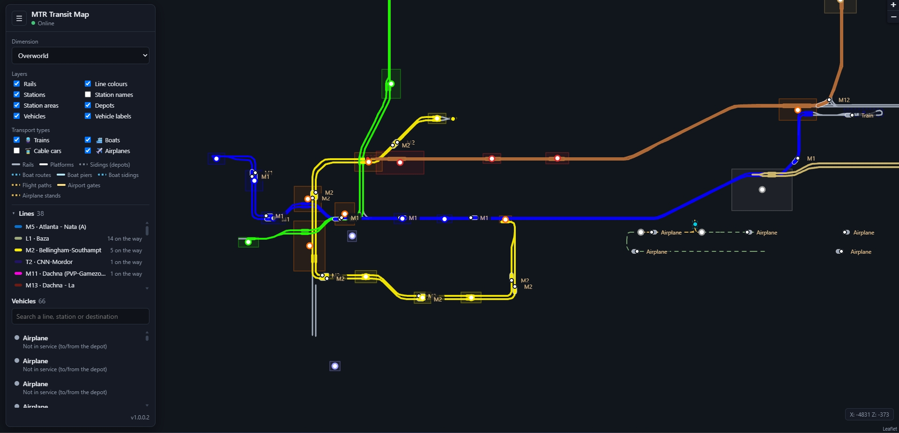
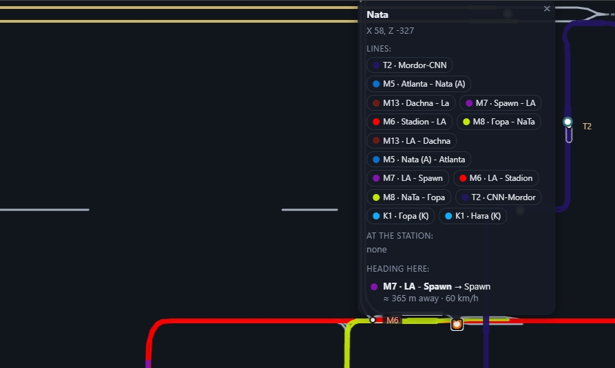
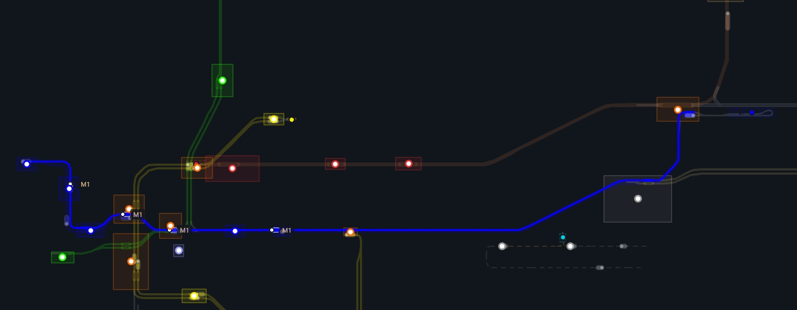
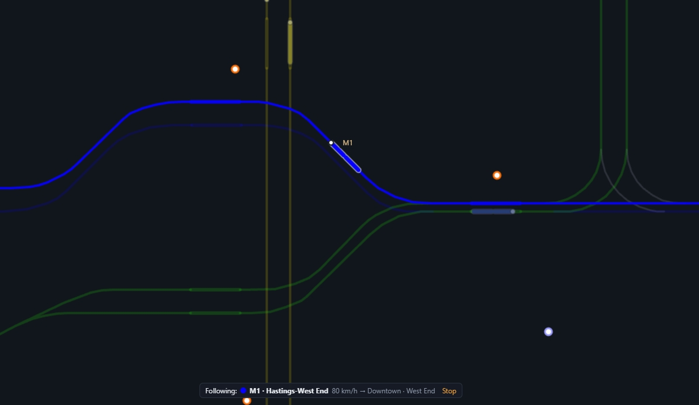
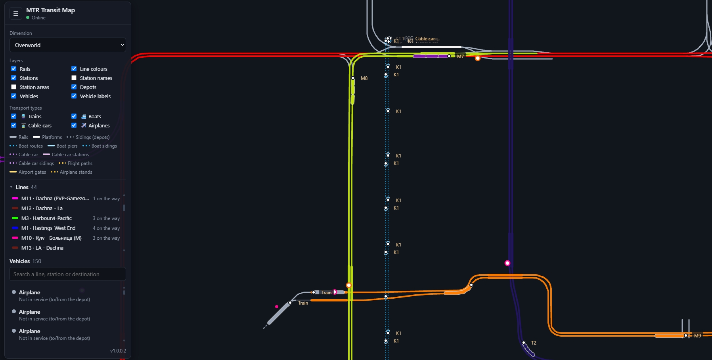

# 🚇 MTR-Dynmap Bridge — v1.0.0.2

### Live web map of MTR trains, boats, cable cars and airplanes

    

  

The biggest update so far: the plugin now has its **own live web map** — the real layout of your MTR network with every vehicle moving on it, right in the browser. Dynmap markers keep working exactly as before, and Dynmap is now optional.

## 🗺️ Live web map

Open `http://<server-ip>:25970/` or type `/mtrmap` in game.

- 🛤️ **Every MTR rail**, straight and curved, in its real place — drawn **in the colours of your MTR lines**. Platforms and depot sidings are marked, boat routes, cable cars and flight paths have their own style.
- 🚆 **Smoothly moving vehicles** — trains, boats, cable cars and airplanes, coloured like their line, with the line number as a label.
- 🚉 **Stations and depots** with their areas from the MTR dashboard.
- 🧾 **Station window:** the lines stopping there, vehicles **at the station** and vehicles **heading there** with distance and speed — updated live. Click a vehicle to follow it.
- 🎨 **Lines list:** click a line to highlight it on the map and show only its vehicles.
- ☑️ **Transport type switches:** hide trains, boats, cable cars or airplanes with one tick — their rails, vehicles, stations and lines disappear from the map. Each browser remembers the choice.
- 🔎 **Vehicle list** for the selected dimension with search by line, station or destination, and **"follow this vehicle"**.
- 🌍 Dimensions, layer switches, shareable links (the address keeps the current view).
- 🇬🇧 / 🇷🇺 **English and Russian** interface (`language` in `config.yml`, or `?lang=ru` in the address).
- 🔗 Optional links to your Dynmap and to MTR's own system map.

  
  
   
  
  
   
  <i>Station window · a highlighted line · following a train · metro lines next to a cable car.</i>

## ⚡ Light on the server

- Vehicle positions are read **on MTR's own simulation thread**, the same way MTR's own website reads them — the Minecraft server thread is never used.
- Rail shapes are calculated once and cached until a rail changes.
- The website runs in separate threads, and browsers receive **only what changed**.

## 📍 Dynmap

- Same markers as before (`pin` stations, `building` depots, marker set **MTR**) — existing markers are simply kept up to date.
- **Dynmap is optional** now: without it the web map and commands keep working.
- New settings: `dynmap.sync-interval-minutes` (60 by default), `dynmap.station-icon`, `dynmap.depot-icon`.
- Markers are no longer removed if MTR did not answer in time.

## 🛠️ Also new

- `/mtrmap` (`/transitmap`) — clickable link to the map for every player.
- `/mtrstations [search]`, `/mtrroutes [search]` — lists for admins, with vehicles per route.
- `stations.txt` / `routes.txt` exports.
- `blacklist-stations.yml` and `blacklist-routes.yml`.
- Quieter console: no more log lines on every synchronization check.

> [!NOTE]
> Updating from 1.0.0.1? Keep your `config.yml` — the new settings are appended to it automatically with comments, and your `worlds:` mappings stay as they are.

## ⚙️ Upgrade

1. Replace the old jar in `plugins` with `MTR-Dynmap-Bridge-1.0.0.2.jar`.
2. Open TCP port **25970** (or set another `web-map.port`).
3. Restart the server and open `http://<server-ip>:25970/`.

## 📋 Requirements

- Java 21+ (standard JDK/JRE with the `jdk.httpserver` module)
- Minecraft 1.21.1 / 1.21.4 — Youer or another NeoForge + Bukkit hybrid server
- MTR 4.1.0-beta.2 · Dynmap optional (3.7-beta8 tested)
