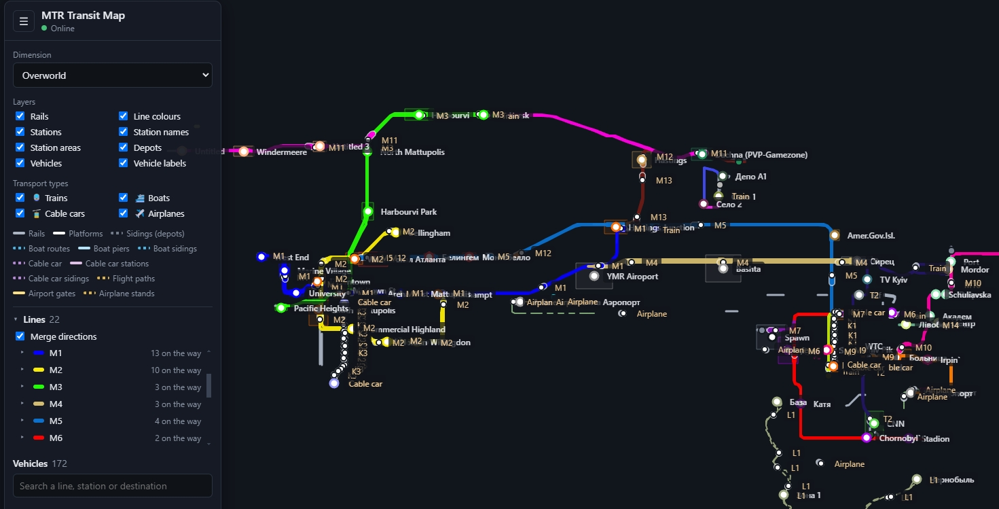
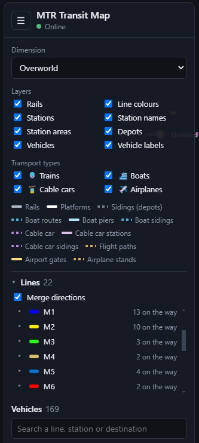

# 🚇 MTR-Dynmap Bridge — v1.0.0.3

### Lines with both directions, and departures by direction in the station window

    

  

In MTR a line is usually built as two routes — one from the first station to the last, and one back. Until now the web map listed them separately, so every line appeared twice. Now the two directions are **one line**, just like on MTR's own system map.

## 🚇 One line, both directions

- ☑️ New **Merge directions** tick in the **Lines** list. Routes with the same number become one line (routes without a number are matched by name and colour). It is on by default, and each browser remembers the choice.
- 🎨 **Click a line** to highlight the whole line in both directions — the rest of the network fades out, as before, and the vehicle list shows only that line.
- ▸ **Open a line** with the arrow to see its directions, e.g. `A1 → A2` and `A2 → A1`. Click a direction to highlight only that one. Circular lines show **clockwise** / **anticlockwise**.
- 🔢 The vehicle counter shows all vehicles of the line on the way.
- Untick **Merge directions** to get the old list with every route on its own row.

## 🧾 Station window by direction

- New **Directions** section: for every line stopping at the station, the vehicles **standing there** and the vehicles **on their way** — split by direction (`M10 → A2`, `M10 → A1`), with distance and speed, updated live.
- Click a direction to highlight it on the map, click a vehicle to follow it.
- Line chips in the window select the whole line.

## 🛠️ Under the hood

- The plugin now also reads the **first and last station** of every MTR route and whether the route is **circular** — that is where the direction names come from. Nothing new runs on the Minecraft server thread.

> [!NOTE]
> Updating from 1.0.0.2? Just replace the jar — `config.yml` does not change in this version.

## ⚙️ Upgrade

1. Delete the old jar from `plugins` and put in `MTR-Dynmap-Bridge-1.0.0.3.jar`.
2. Restart the server.
3. Reload the web map in the browser with **Ctrl + F5**, so it loads the new website files.

## 📋 Requirements

- Java 21+ (standard JDK/JRE with the `jdk.httpserver` module)
- Minecraft 1.21.1 / 1.21.4 — Youer or another NeoForge + Bukkit hybrid server
- MTR 4.1.0-beta.2 · Dynmap optional (3.7-beta8 tested)
